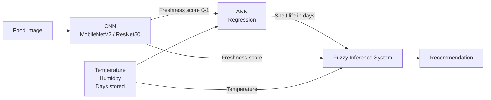

# 🍎 Hybrid Food Freshness & Shelf-Life Estimator
### CNN + ANN + Fuzzy Logic

A soft-computing project that looks at a photo of a fruit or vegetable, combines it with storage conditions, and tells you **how fresh it is, how many days it will last, and what to do with it**.

---

## 📌 Table of Contents
1. [Overview](#-overview)
2. [Problem Statement](#-problem-statement)
3. [Objectives](#-objectives)
4. [System Architecture](#-system-architecture)
5. [Datasets](#-datasets)
6. [Methodology](#-methodology)
7. [Repository Structure](#-repository-structure)
8. [Running on Kaggle](#-running-on-kaggle)
9. [Evaluation](#-evaluation)
10. [Results](#-results)
11. [Demo](#-demo)
12. [Limitations](#-limitations)
13. [Future Scope](#-future-scope)
14. [Tech Stack](#-tech-stack)
15. [References & License](#-references--license)

---

## 🔍 Overview

Food waste is largely caused by the difficulty of judging freshness and remaining shelf life. This project builds a **three-stage hybrid system**, where each technique does the job it is best at:

| Stage | Technique | Job |
|-------|-----------|-----|
| 1 | **CNN** | Reads the image and outputs a freshness score |
| 2 | **ANN** | Predicts remaining shelf life (days) from the freshness score and storage conditions |
| 3 | **Fuzzy Logic** | Turns numbers into a human-friendly recommendation |

**Example output**

```
Input  : banana.jpg | Temp = 28°C | Humidity = 60% | Stored = 4 days
CNN    : Freshness score = 0.42 (Medium)
ANN    : Predicted shelf life = 1.8 days
Fuzzy  : Urgency = 78/100
Action : ➜ CONSUME NOW
```

---

## ❓ Problem Statement

- Visual inspection is **subjective** and varies from person to person.
- Sensor-only methods **ignore the actual appearance** of the food.
- A single model outputs raw numbers that are **hard for ordinary users to act on**.

A combined approach handles the **image**, the **storage environment**, and the **final decision** together.

---

## 🎯 Objectives

1. Classify fruit/vegetable freshness from images using a **CNN**.
2. Predict remaining shelf life (in days) using an **ANN**.
3. Generate an actionable recommendation using a **fuzzy inference system**.
4. Evaluate each module and the full pipeline.

**Scope:** Selected fruits and vegetables (e.g., apple, banana, orange). Each input is one image plus storage temperature, humidity and days stored.

---

## 🏗 System Architecture



Plain-text version:

```
Image ──► CNN ──► freshness score ──┐
                                    ├──► ANN ──► shelf life ──┐
Temp, Humidity, Days stored ────────┘                         ├──► Fuzzy ──► Action
                    freshness score + temperature ────────────┘
```

---

## 📦 Datasets

### 1. Image data (real)
Combine two or more public Kaggle datasets (search by title):

- **Fruits fresh and rotten for classification** (~13k images: apples, bananas, oranges)
- **Fresh and Stale Classification** (fruits and vegetables)
- **Fruit and Vegetable Disease (Healthy vs Rotten)**

Check the exact class names after adding them, and map them to a common label set (fresh / medium / rotten, or fresh / rotten).

**Split:** 70% train / 15% validation / 15% test (stratified).

### 2. Sensor data (synthetic)
No public image dataset includes temperature, humidity or shelf-life days, so these records are **simulated**:

| Column | Description | Range |
|--------|-------------|-------|
| `freshness_score` | Simulated or CNN-derived score | 0 to 1 |
| `temperature` | Storage temperature (°C) | 2 to 35 |
| `humidity` | Relative humidity (%) | 30 to 95 |
| `days_stored` | Days since purchase | 0 to 14 |
| `shelf_life` | **Target**: remaining days | ≥ 0 |

Illustrative generation formula (tune the constants per fruit):

```python
rate_factor = 2 ** ((temp - 5) / 10) * (1 + 0.02 * abs(humidity - 90))
effective_age = days_stored * rate_factor
shelf_life = max(0, shelf_life_ref * freshness_score - effective_age + noise)
```

> ⚠️ **Note:** Sensor data is simulated for academic demonstration. Results on it show the pipeline works, not real-world spoilage accuracy.

---

## 🧪 Methodology

### Module 1: CNN (image → freshness score)
- **Preprocessing:** resize to 224×224, normalize, augment (flip, rotation, brightness)
- **Model:** MobileNetV2 or ResNet50 with transfer learning (ImageNet weights, frozen base, then optional fine-tuning)
- **Head:** Global average pooling → Dense → Dropout → softmax (class) or sigmoid (score)
- **Output:** freshness score (0 to 1) or class (fresh / medium / rotten)

### Module 2: ANN (shelf-life prediction)
- **Inputs:** CNN score, temperature, humidity, days stored (scaled with `StandardScaler`)
- **Architecture:** Dense 64 → 32 → 16 (ReLU), linear output
- **Loss:** MSE | **Metrics:** MAE, RMSE, R²

### Module 3: Fuzzy Inference System
- **Inputs:** freshness score, predicted shelf life, temperature
- **Membership functions:** low / medium / high (triangular or trapezoidal)
- **Rules:** 10 to 15 IF-THEN rules, e.g.
  - IF freshness is **high** AND shelf life is **long** THEN action is **Safe to store**
  - IF freshness is **low** AND shelf life is **short** THEN action is **Discard**
  - IF freshness is **medium** AND temperature is **high** THEN action is **Consume now**
- **Defuzzification:** centroid → urgency score (0 to 100)
- **Output mapping:**

| Urgency score | Recommendation |
|---------------|----------------|
| 0 to 25 | ✅ Safe to store |
| 25 to 50 | 🕒 Use within 2 days |
| 50 to 80 | 🍽 Consume now |
| 80 to 100 | 🗑 Discard |

*(Adjust thresholds to match your membership functions.)*

---

## 📁 Repository Structure

```
food-freshness-estimator/
│
├── README.md
├── requirements.txt
├── notebooks/
│   ├── 01_data_exploration.ipynb
│   ├── 02_cnn_training.ipynb
│   ├── 03_synthetic_data_and_ann.ipynb
│   ├── 04_fuzzy_system.ipynb
│   └── 05_full_pipeline_demo.ipynb
├── data/
│   ├── synthetic_sensor_data.csv
│   └── README.md            # how to download the Kaggle datasets
├── models/
│   ├── cnn_freshness.h5
│   ├── ann_shelf_life.h5
│   └── scaler.pkl
├── src/
│   ├── cnn_model.py
│   ├── ann_model.py
│   ├── fuzzy_system.py
│   ├── data_generator.py
│   └── pipeline.py
├── results/
│   ├── confusion_matrix.png
│   ├── ann_pred_vs_actual.png
│   └── fuzzy_surface.png
└── docs/
    └── report.pdf
```

*(A single-notebook version also works; split into files only if you want a cleaner repo.)*

---

## ☁️ Running on Kaggle

1. Create a new **Kaggle Notebook**.
2. **Settings → Accelerator → GPU T4**.
3. **Settings → Internet → On** (needed for `pip install`).
4. Click **Add Data** and add the fruit freshness datasets. They appear under `/kaggle/input/`.
5. Install the fuzzy library:
   ```python
   !pip install scikit-fuzzy
   ```
6. Run the notebooks in order (01 → 05).
7. Save models to `/kaggle/working/`:
   ```python
   model.save('/kaggle/working/cnn_freshness.h5')
   ```
8. Download outputs from the **Output** tab, then commit them to your repo.

### Running locally (optional)

```bash
git clone https://github.com/<your-username>/food-freshness-estimator.git
cd food-freshness-estimator
pip install -r requirements.txt
```

**requirements.txt**
```
tensorflow
numpy
pandas
scikit-learn
scikit-fuzzy
matplotlib
seaborn
```

---

## 📊 Evaluation

| Module | Metrics / Checks |
|--------|------------------|
| CNN | Accuracy, precision, recall, F1, confusion matrix |
| ANN | MAE, RMSE, R², predicted vs. actual plot |
| Fuzzy | Sanity checks on sample cases, membership function and surface plots |
| Full pipeline | Test images under different conditions; verify recommendations are sensible |

---

## 📈 Results

*(Fill in after training.)*

| Module | Metric | Value |
|--------|--------|-------|
| CNN | Test accuracy | _TBD_ |
| CNN | F1-score | _TBD_ |
| ANN | MAE (days) | _TBD_ |
| ANN | R² | _TBD_ |

Add your plots here:

```markdown


```

---

## 🎬 Demo

```python
from src.pipeline import predict

result = predict(
    image_path="samples/banana.jpg",
    temperature=28,
    humidity=60,
    days_stored=4
)
print(result)
# {'freshness': 0.42, 'shelf_life_days': 1.8, 'action': 'Consume now'}
```

---

## ⚠️ Limitations

- Sensor data is **synthetic**, not from real storage experiments.
- Limited number of food types.
- Lighting and background variation in the images can affect CNN accuracy.
- Fuzzy rules are hand-designed from common-sense knowledge, not learned.

---

## 🚀 Future Scope

- Real **IoT sensors** (temperature, humidity, gas/ethylene).
- **Mobile app** with live camera input.
- More food categories.
- **ANFIS** to learn fuzzy rules automatically from data.
- Grad-CAM visualizations to explain CNN decisions.

---

## 🛠 Tech Stack

`Python` · `TensorFlow / Keras` · `NumPy` · `Pandas` · `scikit-learn` · `scikit-fuzzy` · `Matplotlib` · `Kaggle Notebooks (T4 GPU)`

---

## 📚 References & License

- Kaggle datasets listed above (credit their original authors).
- Howard et al., *MobileNetV2: Inverted Residuals and Linear Bottlenecks*, 2018.
- Zadeh, L. A., *Fuzzy Sets*, 1965.

Released under the **MIT License**. Add a `LICENSE` file to the repo.

---

## 👤 Author

**Your Name** · Your College / Department · Academic Year
